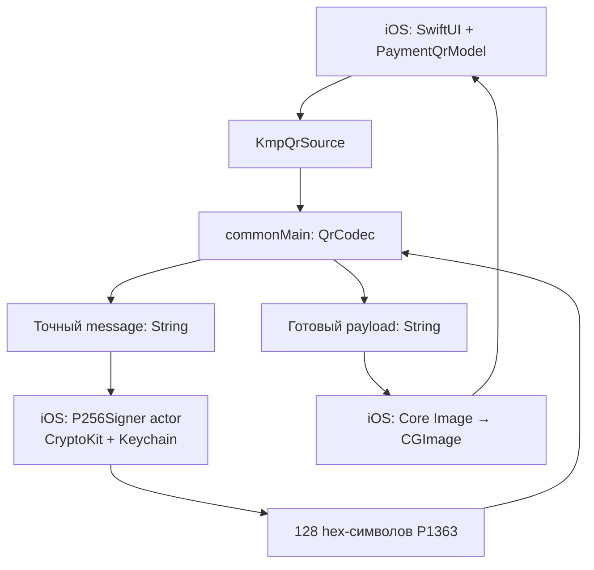

# Архитектура KMP и отдельный SwiftUI-интерфейс

## 1. Граница ответственности



Общую бизнес-логику и платформенный UI можно разделять в KMP; библиотека shared подключается к iOS как framework. Основа интеграции: [структура KMP](https://kotlinlang.org/docs/multiplatform/multiplatform-share-on-platforms.html), [подключение shared к iOS](https://kotlinlang.org/docs/multiplatform/multiplatform-integrate-in-existing-app.html).

| Слой | Содержимое |
|---|---|
| commonMain / protocol | Порядок полей, валидация, hex, DER ↔ P1363, идентификаторы |
| commonMain / domain | Профиль привязки, сценарии импорта/регистрации, состояния, политика обновления |
| commonMain / data, следующий этап | DTO, X5/банк API, репозитории, обработка ответа |
| Android | AndroidKeyStore / Signature, QR-рисование, Android UI |
| iOS Swift | CryptoKit, Keychain, Core Image, SwiftUI |

Формирование message и payload не дублировать в Swift. Приватный ключ не передавать в Kotlin-модель, StateFlow или UI-состояние. Shared работает с keyRef/public key и результатом подписи.

## 2. Предлагаемая структура приложения

```text
shared/src/commonMain/kotlin/
  protocol/             # reference/commonMain
  domain/
    RegisteredBinding
    BindingRepository
    RegistrationState
    RegistrationCoordinator
  data/                 # позже: сеть и DTO
shared/src/androidMain/kotlin/
  AndroidSigningService
  AndroidSecureStorage
iosApp/
  Crypto/P256Signer.swift
  Data/BindingRepository.swift
  QR/QRRenderer.swift
  QR/KmpQrSource.swift
  QR/PaymentQrScreen.swift
```

Создать обычный KMP shared-модуль текущим шаблоном IDE, оставить iOS UI в SwiftUI. iOS targets: iosArm64 и iosSimulatorArm64. JVM target полезен для быстрых тестов. Android target/plugin и версии Gradle брать из выбранного совместимого шаблона проекта; этот пакет не фиксирует весь build toolchain.

В commonMain для расчёта BLAKE2b используется:

```kotlin
implementation("org.kotlincrypto.hash:blake2:0.8.0")
```

На iOS targets настроить обычный framework:

```kotlin
// Фрагмент конфигурации: использовать уже объявленные targets шаблона.
listOf(iosArm64(), iosSimulatorArm64()).forEach { target ->
    target.binaries.framework {
        baseName = "Shared"
        isStatic = true
    }
}
```

Не объявлять targets повторно, если шаблон уже их создал. Swift helpers в этом пакете проверялись с Swift 6 и default actor isolation Nonisolated; MainActor задан явно для UI/source. Если в host app default isolation MainActor, вынести криптографические helpers в модуль с Nonisolated default либо явно согласовать их isolation с actor.

Это версия из просмотренного [README KotlinCrypto/hash](https://github.com/KotlinCrypto/hash). Её совместимость с выбранной Kotlin/Native toolchain проверить при Gradle sync и сборке всех targets. Для первого MVP, в котором импортирован готовый WireProfile, IdentityDerivation и BLAKE2b вообще не нужны на пути ежедневной генерации QR.

## 3. Простая граница Kotlin/Swift

`QrCodec` экспортирует три синхронные операции:

```kotlin
paymentMessage(profile: WireProfile, utc: String): String
bankMessage(profile: WireProfile, utc: String): String
assemble(message: String, signatureHex: String): String
```

Все ошибки протокола — QrProtocolException, экспортируемая через @Throws. В выбранном Objective-C framework bridge это важно: неперехваченные Kotlin-исключения не становятся автоматически обычными Swift errors. [Правила Kotlin/Swift interop](https://kotlinlang.org/docs/native-objc-interop.html#errors-and-exceptions).

Reference использует стандартный Objective-C framework bridge с именем **Shared**, без экспериментального Swift export и без обязательной зависимости на Flow-to-Swift библиотеки. Если у framework другое имя, заменить import Shared и условие canImport(Shared).

Ожидаемый вызов из Swift:

```swift
let message = try codec.paymentMessage(profile: profile, utc: utc14(date))
let signature = try await signer.sign(
    message: message,
    expectedSpkiHex: binding.publicKeySpkiHex
)
let payload = try codec.assemble(message: message, signatureHex: signature)
```

Проверить сгенерированный Shared.h и Xcode autocomplete: экспортируемые имена могут зависеть от конфигурации. `KmpQrSource.swift` — конкретное место для такого согласования; полный bridge ещё не собран в этом пакете.

Такой интерфейс не требует преобразования Data ↔ KotlinByteArray на каждый QR и не связывает UI с suspend/Flow. Если позже сеть/RegistrationCoordinator экспортируются как suspend/Flow, отдельно реализовать отмену, lifetime наблюдения и отображение ошибок: Swift Task cancellation нельзя молча считать полной отменой KMP-операции.

## 4. Хранилище привязки

Модель RegisteredBinding должна содержать:

```text
schemaVersion
derivationProfile             # android-sdk-v1 либо imported-existing
keyRef                        # ссылка на ключ, не сам ключ
publicKeySec1Hex
publicKeySpkiHex
mobileDeviceId
userAppId
keyId
wireProfile                   # карта, телефон, версии, merchant, модель/modelId
keyValidUntil                 # дата из ответа X5, не TTL QR
lastKnownBankDeviceStatus
lastStatusCheckedAt
```

Seed и ключ хранить как секреты. При миграции готовой зарегистрированной идентичности для ежедневного QR достаточно сохранённого userAppId; seed нужен для воспроизведения derivation/целостности импорта и дальнейшего управления идентичностью. Не генерировать seed заново, если он временно недоступен.

Состояния хранилища:

- Нет привязки: показать импорт/подключение.
- Привязка есть, ключ недоступен: показать восстановление доступа, не создавать новый ключ.
- Привязка и ключ есть, статус не проверен сейчас: генерация возможна по локальной политике, UI честно показывает дату последней проверки.
- Сервер явно сообщил revoked: убрать платёжный QR и предложить явное переподключение.

Ключ и metadata связывать сравнением публичного ключа. `expectedSpkiHex` в P256Signer предотвращает подпись случайно другим ключом из хранилища.

## 5. Ключи на iOS

### MVP: программный P-256 ключ в Keychain

`P256Signer.swift`:

- Импортирует PKCS#8 PEM через CryptoKit.
- Сравнивает публичный SPKI с ожидаемым.
- Сохраняет raw private key как generic-password item.
- Использует WhenUnlockedThisDeviceOnly, synchronizable=false.
- Не перезаписывает существующий alias.
- При отсутствии ключа возвращает ошибку; sign() не вызывает createNew().

Это **программный ключ, защищённый Keychain**, а не Secure Enclave. Доступность WhenUnlockedThisDeviceOnly ограничивает чтение разблокированным устройством и не переносит item на другое устройство. [Apple: accessibility](https://developer.apple.com/documentation/security/ksecattraccessiblewhenunlockedthisdeviceonly).

Keychain операции выполняются внутри отдельного actor. Apple отмечает, что SecItemAdd блокирует вызывающий поток; вынос из MainActor нужен для отзывчивого интерфейса. [SecItemAdd](https://developer.apple.com/documentation/security/secitemadd(_:_:)).

`KeychainBlobStore` — минимальный reference для одного ключа. BindingRepository, журнал импорта/регистрации, хранение metadata и атомарная активация привязки остаются обязанностью приложения. Не выдавать этот helper за готовое хранилище всей регистрации.

### Следующий вариант: Secure Enclave

Новый ключ можно создавать через SecureEnclave.P256.Signing.PrivateKey на поддерживаемом устройстве. Но **существующий PEM нельзя импортировать в Secure Enclave**: потребуется другой ключ и новая регистрация. Для восстановления SE-key использовать предусмотренное API сохранённое представление/ссылку; это не обычный raw private key. [Apple: ограничения Secure Enclave](https://developer.apple.com/documentation/security/protecting-keys-with-the-secure-enclave).

Не включать автоматически биометрическое подтверждение на каждую подпись, если UI должен обновлять QR без диалога каждые несколько секунд. Требование user presence — отдельная продуктовая политика с явным действием разблокировки.

## 6. Android-адаптер

Для нового устройства: EC KeyPairGenerator в AndroidKeyStore, curve secp256r1, purposes sign/verify, digest SHA-256. Подпись:

```kotlin
val der = Signature.getInstance("SHA256withECDSA").run {
    initSign(privateKeyFromKeystore)
    update(message.encodeToByteArray())
    sign()
}
val raw = DerCodec.derToRaw(der)
```

Публичная SEC1-точка — x/y с **правильным** unsigned padding до 32 байт. `BigInteger.toByteArray()` нельзя просто скопировать как x32/y32. Отдельная особенность sdkPublicString используется только в derivation идентификатора.

Импорт существующего программного ключа в AndroidKeyStore и аппаратная защита — отдельный сценарий, не доказанный этим пакетом. Он не равен генерации нового аппаратно защищённого ключа. Первый Android signer можно реализовать отдельно от iOS, сохраняя тот же контракт результата — 64 байта P1363.

## 7. Нативный экран iOS

Reference PaymentQrScreen.swift — компонент iOS 17+, который принимает источник payload и маскированный номер карты. Сам экран не авторизуется, не генерирует ключ и не регистрирует устройство.

Композиция:

- Нативный navigation bar «Моя карта».
- Номер с маскировкой.
- Крупная QR-картинка на сплошном белом фоне; украшения располагаются вокруг неё.
- Время создания, а не выдуманный срок действия.
- Кнопка «Обновить QR».
- Состояния создания, недоступного ключа и ошибки.

Рисование: Core Image CIQRCodeGenerator, UTF-8 payload, correction level M. QRRenderer добавляет минимум четыре белых модуля с каждой стороны и масштабирует целым коэффициентом без сглаживания. SwiftUI использует interpolation(.none). [Apple: QR generator](https://developer.apple.com/documentation/coreimage/ciqrcodegenerator).

Скругления, градиенты и материалы можно применять к внешней карточке. Не изменять модули QR, не накладывать логотип на данные и не обрезать белую рамку. Поддержать светлый и тёмный интерфейс, сохраняя сам QR чёрным на белом.

Reference обновляет код при active scenePhase и по кнопке. При background/disappear скрывает кадр и инвалидирует результат незавершённой генерации через revision. Таймер обновления можно добавить позже; его интервал не обозначает известный банковский TTL.

В reference Core Image рендерится в MainActor после фоновой подписи. Если измерения покажут заметную задержку, вынести renderer на отдельную очередь/actor с корректным Sendable-контрактом для выбранной Swift toolchain. Не переносить UIImage/CGImage между executors через unchecked Sendable без отдельного решения.

## 8. Данные UI и жизненный цикл

Готовый QR — результат на конкретный момент, не длительно сохраняемый ViewModel-state. При смене аккаунта/привязки инвалидировать текущий source и кадр, даже если предыдущая задача подписи завершится позже.

В UI нельзя показывать «Оплата подтверждена» по факту создания картинки. Успех подписания, зарегистрированность устройства и фактический платёж — три разных состояния.

Тексты ошибок должны различать: «Нет привязки», «Ключ недоступен», «Привязка отозвана», «Не удалось проверить статус». Технические журналы могут содержать код ошибки, фазу и время; private key, OTP, Bearer и полный платёжный payload в обычные логи не записывать.
