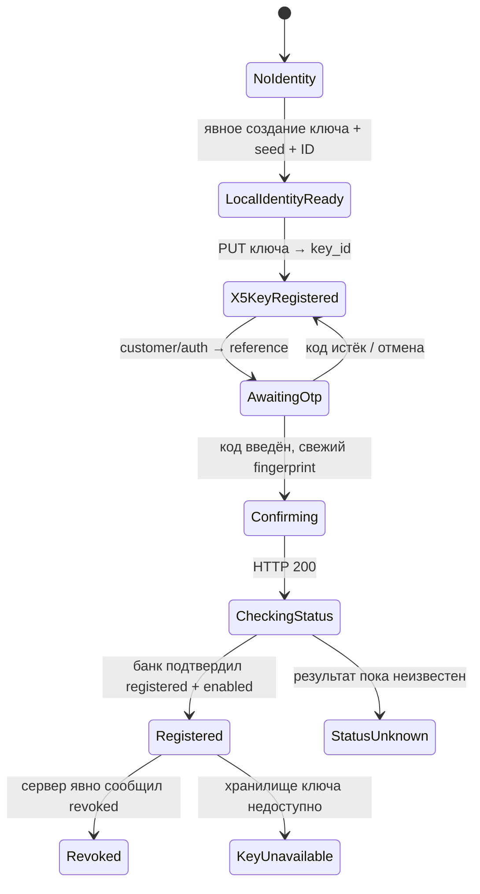

# Регистрация нового ключа и сетевые контракты

Этот сценарий нужен только для новой привязки. Для первого iOS MVP с нашим существующим ключом см. [MIGRATION.md](MIGRATION.md).

Ниже — наблюдаемые API из успешного эксперимента, а не опубликованный X5 SDK-контракт с гарантией совместимости. Документация не вызывает эти API и не меняет текущую регистрацию.

## 1. Состояния



TransportError/RegistrationUnknown нужны как дополнительные состояния для неоднозначного результата запроса. Истечение Bearer относится к сетевой сессии, не означает потерю private key и само по себе не требует новой пары.

Созданные ключ, seed, user_app_id и mobile_device_id сохранить **до первого сетевого запроса**. После перезапуска приложение продолжает сценарий с той же идентичностью.

## 2. Авторизация

X5ID выдаёт access JWT после входа пользователя. В нашем прототипе использовался серверный Bearer из собственной авторизованной сессии. JWT не нужно самостоятельно подписывать или «генерировать» из его payload.

За интерфейсом AuthSessionProvider разместить получение/refresh access token. Полный login нового KMP-клиента ещё не воспроизведён. Отдельно интегрировать поддерживаемый OAuth/OIDC вход через системный браузер с PKCE и корректным redirect URI/client configuration. Данные клиента из исследованного приложения не считать автоматически готовой конфигурацией нового приложения. Dev-импорт существующего access token отделить от пользовательского входа.

Для офлайн-экрана QR AuthSessionProvider не вызывается. Приватный EC-ключ генератора и access JWT имеют разное назначение и срок жизни.

## 3. Регистрация публичного ключа в X5

```http
PUT https://x5m.x5.ru/common/api/cards/public/v1/qr-public-key
Authorization: Bearer <access token>
x-authorization: Bearer <тот же access token>
x-device-id: <mobile_device_id UUID>
x-platform: <platform string>
x-app-version: <client version>
x-package-name: <client package>
x-capabilities: <client capability string>
x-sign: <request JWT, если используется клиентом>
Content-Type: application/json
```

```json
{
  "public_key": "<hex(04 || x32 || y32)>",
  "mobile_device_id": "<тот же UUID>"
}
```

Успешный ответ нашего эксперимента:

```json
{
  "data": {
    "key_id": 85898710,
    "state": "Success",
    "http_code": 200,
    "valid_until": "2027-10-28"
  }
}
```

HTTP 200 без ожидаемых state/key_id не переводит сценарий в X5KeyRegistered. Сохранить key_id, исходный public key, mobile_device_id и valid_until вместе с текущим keyRef. В модели приложения key_id удобно хранить строкой: конвертировать JSON decimal без Double.

x-capabilities в работающем прототипе имел структуру:

```text
tenant=tsx;clientVersion=<version>;OS=<platform>;source=mob-app;teamId=x5m;timeZone=+3;deviceName=<model>;tsxVersion=<tsx version>
```

При GET списка карт отсутствие этого заголовка давало HTTP 400 с сообщением об отсутствии x-capabilities. Для отдельных заголовков/их значений полный набор обязательных требований не исследован. WireProfile и HTTP client metadata хранить как разные объекты, не собирать их из случайных UI-строк.

### x-sign

Android-клиент использует JWT HS256:

```json
{"alg":"HS256","typ":"JWT"}
```

```text
claims:
  device_id      = mobile_device_id
  timestamp      = floor(unix_seconds / 1000)
  platform       = client platform string
  sdk_version    = client version
  request_url    = полный URL, включая query
  request_method = HTTP method, например PUT

unsigned = base64url(UTF8(headerJson)) + "." + base64url(UTF8(claimsJson))
jwt = unsigned + "." + base64url(HMAC_SHA256(clientSignKey, UTF8(unsigned)))
```

Время именно seconds/1000, а не milliseconds: это воспроизводит просмотренный Android-код. Base64url — без `=`. ClientSignKey не является приватным P-256 ключом пользователя. Его значение в пакет не включено. Ключ Android из APK не проверял захваченный iOS x-sign; iOS-значение не установлено.

GET списка карт принимал повреждённый/отсутствующий x-sign, поэтому успешный GET не доказывает корректность HS256 или отсутствие проверки на PUT. RequestSigner должен быть заменяемым адаптером конфигурации сети.

## 4. Запрос банковского подтверждения

```http
POST https://myapelsin.ru/api/v1/bank/customer/auth
Authorization: Bearer <access token>
Content-Type: application/json
```

```json
{"is_pay_and_view_confirmed": true}
```

Это поле относится к подтверждённому пользовательскому действию в сценарии подключения. В UI показать действие подключения и известный эффект отзыва прежних привязок до отправки, не выполнять запрос в фоне при запуске.

Ответ:

```json
{
  "reference": "<server reference>",
  "auth_code_expiration_period": 180,
  "check_code_rest_count": 0
}
```

Показать OTP-поле, сохранять reference только для текущей попытки, отсчитывать срок из ответа по monotonic clock. Семантика check_code_rest_count отдельно не установлена; не показывать его как точно известное число оставшихся попыток.

Системное автозаполнение кода на iOS: textContentType(.oneTimeCode). Сам код не сохранять в профиле/логах. Новый код не запрашивать автоматически из-за каждого render/foreground.

## 5. Подтверждение банковского устройства

После ввода кода:

1. Зафиксировать текущую локальную привязку и её public key.
2. Получить актуальное время.
3. Создать bankMessage через shared QrCodec.
4. Подписать его тем же keyRef.
5. Собрать Device-Fingerprint с **P1363**, а не DER.
6. Немедленно отправить запрос.

```http
POST https://myapelsin.ru/api/v1/bank/customer/auth/confirm
Authorization: Bearer <access token>
Public-Key: <hex(SPKI DER public key)>
Device-Fingerprint: <bankMessage>.<hex(r32 || s32)>
Content-Type: application/json
```

```json
{"reference":"<reference>","code":"<user supplied OTP>"}
```

В успешном прототипе также отправлялись Origin: https://myapelsin.ru и Referer: https://myapelsin.ru/. Их обязательность для нативного клиента отдельно не проверена.

Успешный ответ был HTTP 200 с JSON null. Парсер не должен требовать `{data: ...}`. После ответа **ещё не показывать финальное Registered**: проверить статус.

## 6. Проверки статуса

Банк:

```http
GET https://myapelsin.ru/api/v2/bank/orangepay/status?user_app_id=<user_app_id>
Authorization: Bearer <access token>
```

Ожидаемые наблюдаемые признаки:

```json
{
  "orangepay_status": "orangePayEnabled",
  "device": {
    "user_app_id": "<тот же user_app_id>",
    "status": "appInstanceRegistered"
  }
}
```

Ответ также содержал mobile_phone, x5id и agreement; их не нужно выводить в диагностические логи.

X5:

```http
GET https://x5m.x5.ru/common/api/profits/public/v1/orange-pay/status?device_id=<user_app_id>
```

Несмотря на имя **device_id в query**, сюда в наблюдаемом протоколе передаётся **user_app_id**, а не UUID mobile_device_id.

```json
{
  "data": {
    "is_orange_pay_enabled": true,
    "is_agreements_accepted": true,
    "is_app_instance_registered": true,
    "is_public_key_available": true
  }
}
```

Сохранять время проверки. Неизвестное строковое значение статуса обрабатывать как Unknown, а не Registered. При appInstanceRevoked платежный экран должен показать состояние переподключения.

## 7. Повторные запросы и сбои

| Сбой | Действие приложения |
|---|---|
| Тайм-аут GET | Оставить последнюю проверку, разрешить ограниченный retry |
| Потерян ответ PUT ключа | RegistrationUnknown; не генерировать другую пару. Идемпотентность повторного PUT отдельно не установлена |
| Истёк OTP | Завершить challenge; новый auth только по действию пользователя, сохраняя ту же пару |
| Тайм-аут auth/confirm | Сначала GET статуса; запрос мог завершиться успешно |
| Невалидный fingerprint | Сверить bytes, public key, r || s, timestamp и профиль; не вращать ключ вслепую |
| 401 / истёк access token | Восстановить AuthSession; локальный ключ не менять |
| 403 с HTML вместо JSON | Ошибка HTTP/защитного слоя; не маскировать как ошибку декодирования QR |
| Приложение завершилось в середине | Восстановить сохранённую фазу с тем же keyRef/seed/ID |

Промежуточный disabled/null после подтверждения не доказывает окончательный отказ. Можно предложить повторную проверку или ограниченный polling с backoff; конкретный график polling — политика приложения, не установленный SLA банка.

## 8. Эффект новой регистрации

В нашем эксперименте после успешного подключения нового локального генератора обе прежние платёжные привязки iPhone и Android получили appInstanceRevoked. Общий точный лимит устройств не исследован.

Поэтому шаг «Подключить новый генератор» должен быть явным. Обычные генерация QR, импорт уже сохранённой идентичности и сетевое обновление токена не должны сами инициировать создание новой пары или банковское подключение.
